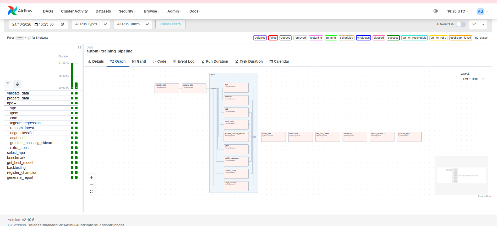
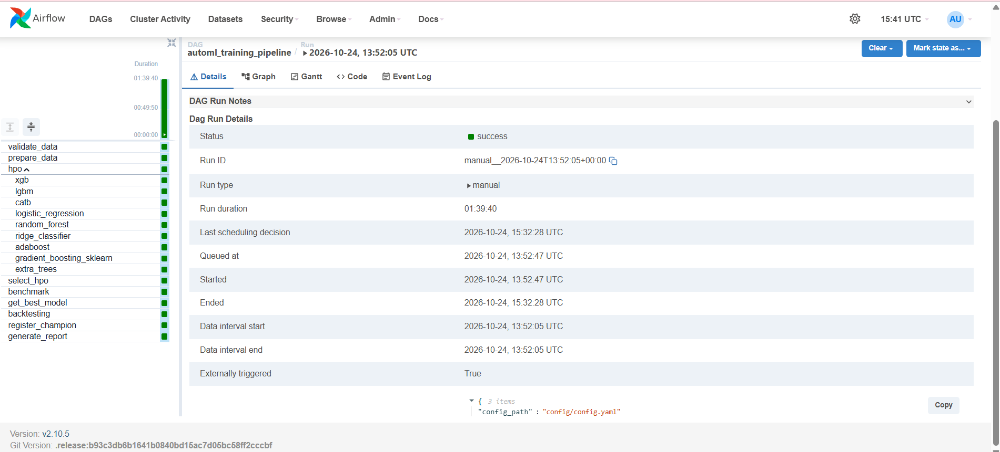
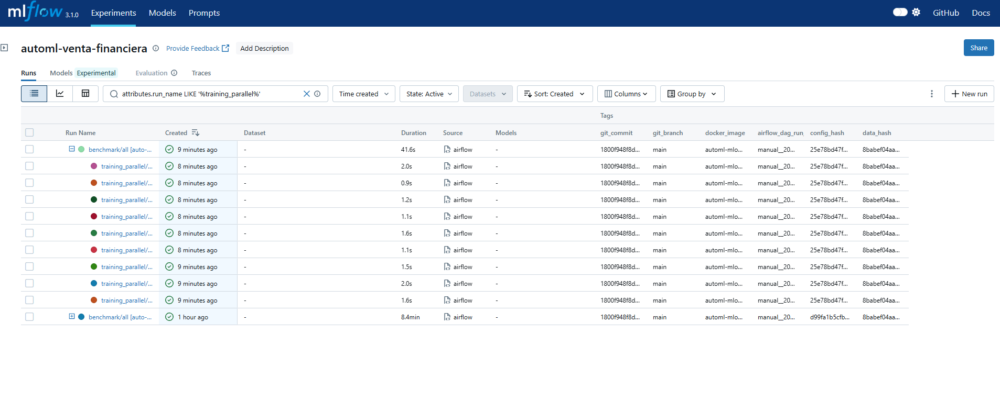
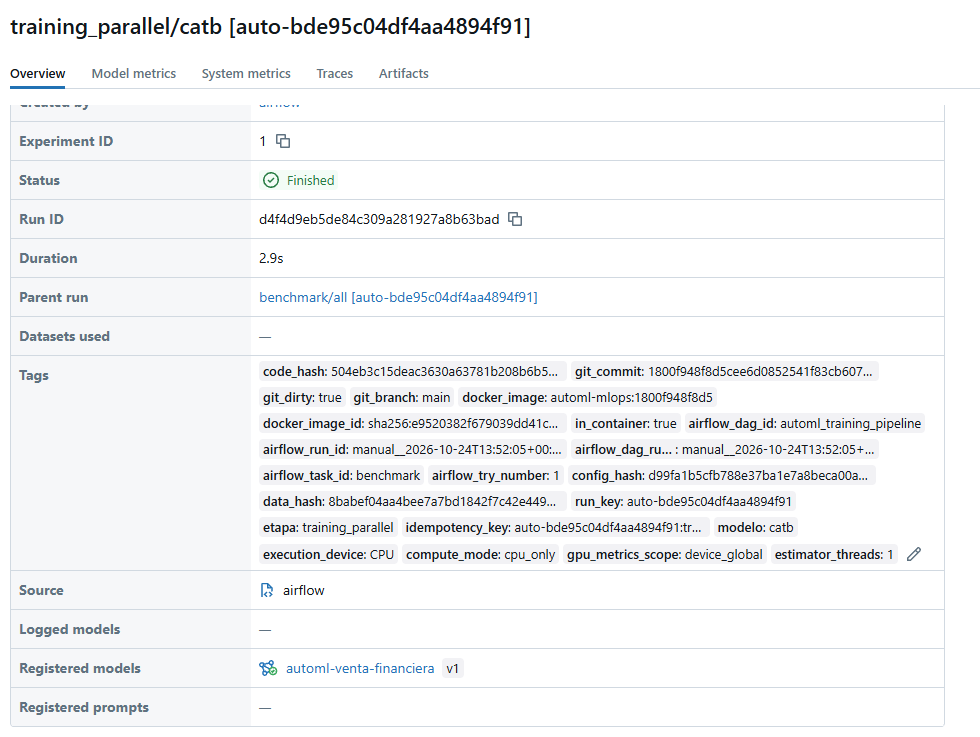
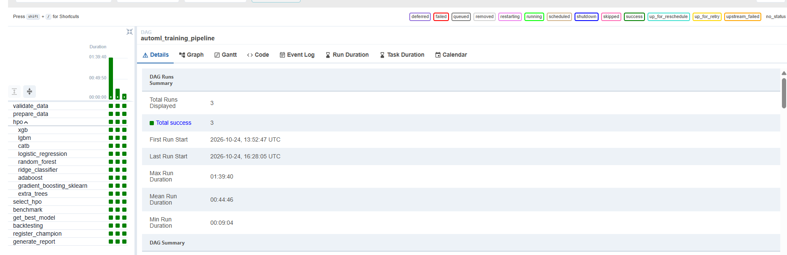
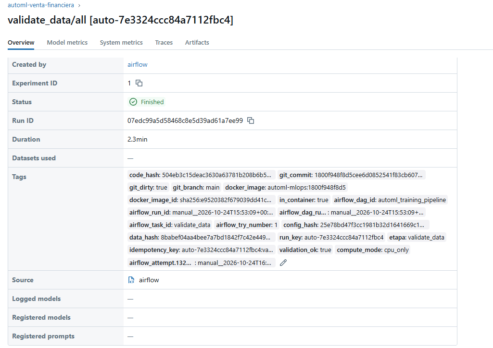

# AutoML — Parcial de orquestación

Continuación de P2 y del avance `automl_p3_mlops_revisado_por_kim.zip`. Mantiene nueve modelos,
Optuna/GridSearch, preprocesamiento dentro de CV, Docker/Airflow/MLflow y captura top-k.
**Integrar en el repositorio de P2 conservando `.git`; no crear otro repositorio.**

## Inicio en Windows (16 GB RAM)

1. Abrir Docker Desktop (contenedores Linux/WSL2).
2. Copiar el contenido de esta carpeta a una rama del repositorio P2. Conservar `.git` y los CSV locales.
   Se renombró el DAG antiguo a `dags/training_dag.py`: eliminar `dags/automl_training_dag.py` si quedó de una copia anterior.
3. Colocar `p1_extrac.csv` ... `p10_extrac.csv` en `data/input/`. Dataset del curso:
   https://drive.google.com/drive/folders/1IKpzgvN9g9SxBO-dOGoWHmc_E-worDXU
   No subir los CSV a Git. Se exige `p_fecinformacion` YYYYMMDD y diez meses consecutivos.
4. Desde la carpeta que contiene `docker-compose.yml`:

```powershell
Copy-Item .env.example .env
python scripts/up.py
```

`up.py` registra commit/rama/imagen y ejecuta build/up. Alternativa:

```powershell
docker compose build
docker compose up -d
docker compose ps
docker compose logs --tail 80 airflow-init airflow-scheduler mlflow
```

Airflow: http://localhost:8080 (`admin` / `admin`, entorno académico local).
MLflow: http://localhost:5000. PostgreSQL es interno para Airflow; MLflow usa SQLite persistente.
No instalar estas aplicaciones en Windows por separado. La construcción descarga paquetes/imágenes y requiere internet.

## Primera corrida pequeña

En Airflow abrir `automl_training_pipeline` → Trigger DAG with config. Usar los parámetros:

```json
{"config_path":"config/smoke.yaml","run_key":"","force":false}
```

El perfil smoke usa 1% de muestra, 2 trials, ejecución secuencial y CPU. El pool HPO tiene 1 slot
por defecto en `config/config.yaml`. Verificar suficientes positivos para CV. El esquema/nulos/fechas
se validan en los archivos completos; la muestra pequeña reduce entrenamiento, no la lectura inicial.
No usar resultados smoke como métricas finales. Perfil normal: `config/config.yaml` (10%, 15 trials,
600 segundos por búsqueda; un trial en curso puede exceder el timeout). El presupuesto por tiempo
puede producir diferente cantidad de trials entre máquinas.

Para cambiar concurrencia del pool editar `airflow.pool_slots` y ejecutar:

```powershell
docker compose exec airflow-scheduler python scripts/configure_pool.py
```

`parallel.mode`: `sequential`, `parallel` o `benchmark`. Benchmark entrena en ambos modos y conserva
ambos artefactos, runs y recursos; el modelo de modo parallel es el candidato final. Un modo único
no tiene speed-up y lo reporta como null. `parallel.workers: 1` está permitido; `-1` usa CPU disponibles.
Para esta laptop empezar con 1 slot HPO y 1–2 workers, sin aumentar memoria de Docker inicialmente.

## GPU opcional

CPU es el valor inicial portable (`use_gpu: false`). Para probar GPU:

```powershell
python scripts/up.py --gpu
```

Activar además `use_gpu: true` en el perfil usado. La reserva GPU del Compose solo expone el hardware;
los backends se prueban con un fit. Si un backend no funciona, queda en CPU. El HPO se mantiene en CPU.
El tag `execution_device` identifica el dispositivo usado. La telemetría GPU es global del dispositivo,
no consumo exclusivo de un modelo. GPU/Windows/WSL2 aún deben comprobarse en la laptop.

## Ejecución local conservada

En Python compatible (se recomienda 3.11 para igualar la imagen):

```powershell
python -m pip install -r requirements.txt
python main.py --input data/input --config config/smoke.yaml
```

Esto ejecuta el pipeline P3 completo sin Airflow, con las mismas funciones de etapas.
Sin `MLFLOW_TRACKING_URI` utiliza SQLite local bajo `data/mlflow`; si se desea el servidor Docker,
configurar `$env:MLFLOW_TRACKING_URI="http://localhost:5000"`.
`python main.py --legacy --config config/config.yaml` conserva la ruta modular P2 y sus switches;
**no es la ruta de entrega P3**, porque no ejecuta el tracking/orquestación completos.
`main_p2.py` conserva la entrada previa; `src/parallelism.py` es un alias compatible de `src/parallel.py`.

## Qué se ejecuta

Validar → preparar → HPO por modelo → consolidar HPO → entrenar/benchmark → seleccionar en holdout
→ evaluar TODOS los artefactos en p7–p10 → registrar/promover → reporte.
XCom contiene solo identificadores. Los datasets/modelos viven en disco compartido/MLflow.
Cada modelo HPO y cada entrenamiento final tiene su run, parámetros, AUC/decay/negocio, modelo, ROC,
backtesting de cuatro olas y cómputo. Los modelos finales no se reentrenan en backtesting.
Si no hay candidato admisible, el pipeline informa `champion: null`, evalúa los candidatos y no promueve.

## Idempotencia (evidencia que deben capturar)

1. Ejecutar con `run_key` vacío y anotar carpeta `auto-*`, IDs y número de runs en MLflow.
2. Volver a disparar el DAG con idénticos parámetros, datos, código e imagen.
3. Todas las etapas completas se reutilizan. Los IDs y número de runs activos e históricos no cambian;
   se añaden tags de intento Airflow y se conserva el identificador de origen.
4. Una tarea incompleta reanuda el mismo run. No se borran runs previos.
5. Cambiar los datos/config/código/imagen produce otra clave automática y conserva la anterior.
   Si se fuerza una etiqueta manual para una identidad distinta, el programa se detiene: usar otra etiqueta.

`force` no destruye resultados completos: permite intentar de nuevo lo incompleto. Para un nuevo
experimento intencional, usar otra etiqueta manual o cambiar la configuración. Los locks requieren
un filesystem compartido (el volumen local del Compose); un despliegue distribuido requeriría locks externos.
No editar código/CSV durante una corrida; la protección de identidad detiene la ejecución si detecta cambios.
La clave incluye un hash del código efectivo además de Git, para detectar modificaciones sin commit.

## Resultados y evidencia

En `data/output/runs/<clave>/`:
- `results_summary.json`: métricas de los nueve modelos finales, tamaño/hash del MISMO artefacto,
  backtesting, selección, promoción y trazabilidad.
- `compute_logs.json`: recursos por etapa (incluida generate_report), HPO y entrenamiento/modo.
- `report.md`: tablas de modelos, 36 filas de backtesting final y recursos por entrenamiento.
- Subdirectorios por etapa, modelos y datos intermedios. MLflow conserva los artefactos pesados.

Las tablas completas de cada corrida están en `data/output/runs/<clave>/report.md`. Un resumen de la corrida
final y la evidencia de idempotencia están abajo y en `docs/`. Conservar una carpeta de corrida con
sus JSON/tablas/gráficos; `.gitignore` excluye datasets, pickles y bundles MLflow. No publicar credenciales.
Los logs de Airflow, PostgreSQL y MLflow persisten en volúmenes. `docker compose down` los conserva;
**no usar `down -v` si quieren conservar experimentos**.

No se incluyen resultados del curso ni capturas fabricadas. Ver [VALIDACION.md](VALIDACION.md) para
el alcance exacto de las pruebas realizadas y [docs/decisiones_diseno.md](docs/decisiones_diseno.md).

### Corrida final (10 % de muestra, 15 trials) — `auto-bde95c04df4aa4894f91`

Ejecutada con Airflow (`manual__2026-10-24T13:52:05`, 17/17 tareas en éxito, ~1 h 40 min), `config/config.yaml`, CPU,
modo paralelo con 2 workers. Datos: meses p1–p6 para desarrollo (127 229 filas de train y 54 531 de validación tras
muestrear el 10 %) y p7–p10 reservados para backtesting.

**Campeón: `catb`** (versión 1 en MLflow, alias `champion`). Captura top-10 % = 0.5257,
AUC validación = 0.8554, decay = 1.80 %. Backtesting sin reentrenar: 4/4 olas válidas y 0 alertas de drift en los 18 artefactos evaluados.

| Modelo | AUC validación | Decay % | Captura top-10 % | AUC medio backtesting (p7–p10) |
|---|---:|---:|---:|---:|
| xgb | 0.8544 | 1.61 | 0.5173 | 0.8435 |
| lgbm | 0.8554 | 4.02 | 0.5213 | 0.8457 |
| catb ★ | 0.8554 | 1.80 | 0.5257 | 0.8434 |
| logistic_regression | 0.8315 | -0.12 | 0.4760 | 0.8134 |
| random_forest | 0.8462 | 15.13 | 0.5034 | 0.8338 |
| ridge_classifier | 0.8298 | -0.11 | 0.4776 | 0.8119 |
| adaboost | 0.8394 | 0.11 | 0.4961 | 0.8255 |
| gradient_boosting_sklearn | 0.8495 | 5.70 | 0.5067 | 0.8377 |
| extra_trees | 0.8239 | 16.21 | 0.4642 | 0.8090 |

`random_forest` y `extra_trees` quedan fuera de la selección por decay > 10 %. `catb` y `lgbm` son prácticamente equivalentes
(captura a menos de 0.005 y AUC casi idéntico); `catb` gana por desempate de AUC.

Observaciones: (1) el límite de 600 s por búsqueda cortó el HPO de `gradient_boosting_sklearn` (2 trials), `adaboost` (7),
`random_forest` (8) y `extra_trees` (11); (2) la corrida fue solo en modo paralelo, por lo que **no hay speed-up medido**
(T_secuencial y speed-up son `null`); (3) se ejecutó con cambios sin commitear (`git_dirty = true`; el `code_hash` identifica el código efectivo).

Detalle completo (HPO por modelo, 36 filas de backtesting, recursos, trazabilidad): [docs/resultados_corrida_final.md](docs/resultados_corrida_final.md).






### Idempotencia (versión rápida)

Se relanzó el DAG con los mismos parámetros sobre una corrida reducida (1 % de muestra, 2 trials, `config.yaml` con
parámetros cambiados desde Airflow; no `smoke.yaml`). Reutilizó la clave `auto-7e3324ccc84a7112fbc4`, no creó runs nuevos
(26 por corrida, 52 en total) y añadió el tag `airflow_attempt.*` a los 17 runs de etapa. No se relanzó la corrida del 10 %.
Detalle y limitaciones: [docs/evidencia_idempotencia.md](docs/evidencia_idempotencia.md).




## Pruebas

```powershell
python tests/test_integracion.py
python tests/test_contratos.py
```

La integración crea datos temporales sintéticos, prueba los nueve modelos, ambos modos, backtesting
sin fit, artefactos, reejecución, registro y protección ante cambios de datos. Requiere dependencias locales
completas o un entorno de pruebas con servidor MLflow. Ver límites de plataforma en VALIDACION.md.

## Git y entrega

Guardar P2 con tag `v2.0-p2`; una rama por contribución, commits reales de cada integrante, PR/merge a main.
Tag `v3.0-parcial` solo después de validar. El repo sigue privado, con acceso docente `manassesmauricio-cloud`.
La entrega es la URL del mismo repo P2, no este ZIP. Este paquete no incluye ni inventa historial Git.

Los notebooks heredados son material de P2; el reporte de P3 se consulta en data/output/runs/<clave>/report.md.
