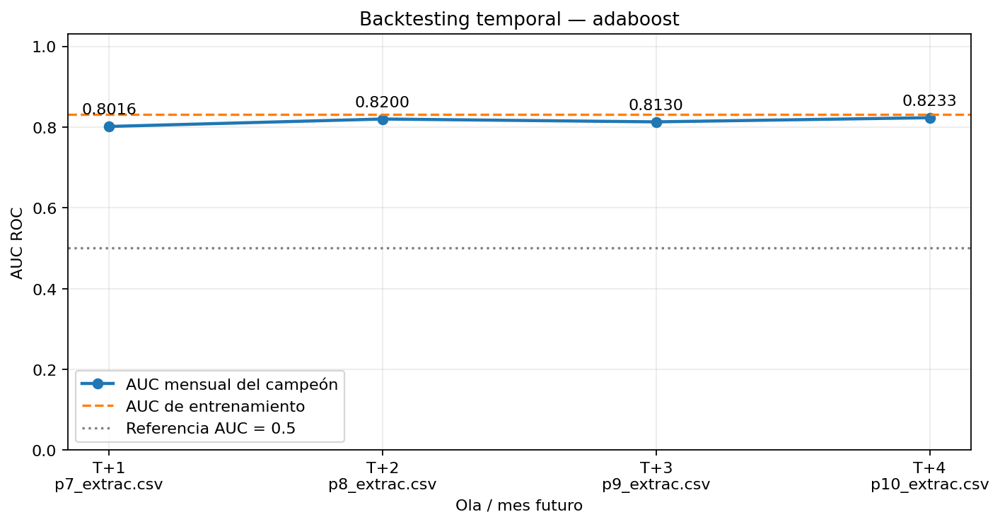

# AutoML de venta financiera con HPO paralelismo y backtesting

Extensión del proyecto original de Milner Quispe, Rosabel Guzman y Kimberly Olivos. Se conserva el código P1 de preprocessing, training, evaluation y registry y se añaden funciones reutilizables P2. La partición fija autorizada es p1–p6 para desarrollo y p7–p10 para evaluación futura. No se usan 14 archivos, p_fecinformacion ni backtest_train_cutoff.

## Instalación y datos

Python 3.11 recomendado en un entorno virtual. Desde esta carpeta:

```bash
python -m pip install -r requirements.txt
python main.py --input data/input --config config/config.yaml --parallel
```

Obtener los diez CSV del [Drive del curso](https://drive.google.com/drive/folders/1IKpzgvN9g9SxBO-dOGoWHmc_E-worDXU), y colocarlos en data/input con los nombres p1_extrac.csv ... p10_extrac.csv. No publicar los datos. Configurar csv_sep y csv_encoding según los archivos. Por defecto se conserva la muestra estratificada del 10%, semilla 42 y split 70/30 de desarrollo. La muestra mantiene proporciones del target; no garantiza representatividad de todas las variables.

## Estructura y continuidad P1

```text
automl_venta_financiera/
  main.py
  config/config.yaml
  src/preprocessing.py
  src/training.py
  src/hpo.py
  src/parallelism.py
  src/backtesting.py
  src/evaluation.py
  src/registry.py
  data/input/
  data/output/YYYY-MM-DD_HH-MM-SS/
  notebooks/validacion.ipynb
  notebooks/backtesting_analysis.ipynb
  requirements.txt
  README.md
```

El selector P1 original permanece en training._GetBestModelP1. training.GetBestModel delega en evaluation.GetBestModel. Antes de disponer de métricas temporales se conserva la política P1; después se aplican sus filtros y estabilidad temporal. Las funciones P1 permanecen disponibles; el preprocesamiento P2 se ajusta dentro del Pipeline para evitar fuga en validación cruzada. Los modelos de la versión original son los nueve candidatos P2.

## Configuración y ejecución independiente

```yaml
modules:
  hpo: true
  parallel: true
  backtesting: true
n_jobs: 2                  # -1 usa os.cpu_count(); controlar RAM al aumentar
parallel_enabled: true     # false: entrenar secuencialmente sin benchmark
use_gpu: true
drift_alert_threshold: 5.0 # puntos absolutos de AUC, no decay relativo
```

--parallel activa el benchmark aun si parallel_enabled es false. El módulo parallel debe estar activado para ejecutar el entrenamiento final. HPO se ejecuta con GridSearchCV para los nueve modelos; los espacios están en config.yaml. El entrenamiento final reutiliza los mejores HP y no repite la búsqueda.

- Flujo completo: config/full.yaml (o config/config.yaml).
- Solo HPO: config/hpo_only.yaml.
- Solo entrenamiento/benchmark: config/parallel_only.yaml; indicar parallel.hpo_run_dir con una corrida HPO compatible.
- Solo evaluación temporal: config/backtesting_only.yaml; indicar backtesting.source_run_dir con la carpeta de entrenamiento o HPO. Debe contener los nueve modelos y sus metadatas.

```bash
python main.py --input data/input --config config/backtesting_only.yaml
```

Para modo secuencial, activar modules.parallel y establecer parallel_enabled: false. Se usan los mismos nueve finalistas y HP; los campos de tiempo paralelo y speed_up quedan null porque no fueron medidos. Se mantienen los switches de las tres secciones para evitar repetir HPO al analizar resultados.

## CPU GPU y medición

parallelism.py orquesta explícitamente joblib.Parallel con backend loky. No confunde n_jobs interno de un estimador con concurrencia de modelos. Cada modelo CPU usa un hilo; los workers lanzan tareas en batches. Se detecta GPU con nvidia-smi y se verifica el backend mediante un fit pequeño. XGBoost, CatBoost y LightGBM se prueban con sus parámetros nativos GPU. LightGBM puede necesitar un build GPU; si no existe se registra el motivo del fallback CPU. Si hay GPU y ningún backend logra usarla, la corrida se detiene y no declara cumplimiento GPU. use_gpu:false es un override explícito para pruebas CPU.

Los modelos sklearn se ejecutan en CPU. Esta entrega no implementa el extra de sustitución completa por cuML/RAPIDS ni afirma que las operaciones de preprocessing usen CuPy. La lectura de la lista del punto 4.2 se adopta como alternativas de backend GPU; si se exigieran cuML y CuPy además de los backends nativos, sería necesaria esa ampliación. RAPIDS requiere un entorno Linux/WSL compatible.

El benchmark entrena secuencial y paralelamente el mismo conjunto, con mismos datos, HP, hardware y dispositivos. Incluye ajuste del preprocesador y entrenamiento, junto con despacho y recuperación de resultados. Excluye carga CSV, HPO, preflight, evaluación y persistencia. Se registra tiempo por modelo, espera GPU, tiempo total de cada modo y speed_up = T_secuencial/T_paralelo.

### Análisis técnico del speed-up

Los procesos loky evitan que el GIL de Python limite las tareas Python CPU, aunque los estimadores también ejecutan código nativo. El número de workers y los núcleos lógicos se registran en parallelism; más workers no garantizan mayor rendimiento. El arranque de procesos, serialización de Pipelines y DataFrames, transferencias y memoria compartida añaden overhead. Con muestras pequeñas ese coste puede superar el ahorro y producir speed_up < 1. La velocidad debe interpretarse junto con RAM, duración y distribución de tareas.

La GPU se protege con un lock: varios entrenamientos no compiten simultáneamente por la VRAM, pero pueden solaparse con CPU. Por ello la parte GPU limita el máximo speed-up y sus esperas explican parte del tiempo paralelo. La CPU mantiene un hilo por estimador para reducir sobreasignación de hilos. Un único benchmark, siempre secuencial primero, no permite atribuir diferencias pequeñas a la concurrencia: caché, calentamiento, temperatura y variación GPU también influyen. Los tiempos por modelo no se suman para obtener el tiempo global paralelo. Este benchmark compara modos de orquestación, no CPU contra GPU.

El bloque de resultados reales se actualiza al ejecutar. No se presentan cifras sintéticas como resultados del dataset del curso.

## Evaluación temporal y selección

Se leen p7–p10 una sola vez y se toma la misma muestra de cada ola para los nueve modelos. Los Pipelines guardados conservan el preprocesamiento aprendido en desarrollo. No se reentrenan con datos futuros. Esta modalidad de origen fijo responde a la restricción expresa de seis archivos de desarrollo y cuatro reservados; no se presenta como expanding walk-forward con reentrenamiento mensual. Los nombres de archivo determinan la cronología declarada, sin inventar fechas.

Para cada modelo:

- AUC mensual, observaciones y tiempo de inferencia por ola.
- decay_pct = 100 × (AUC_train − AUC_mes) / AUC_train.
- auc_drop_pp = 100 × (AUC_train − AUC_mes).
- drift_alert = auc_drop_pp > drift_alert_threshold.
- avg_auc_backtest y avg_decay_pct: media aritmética de las cuatro olas, solo cuando todas son válidas.

Una ola con una clase o muestra vacía tiene AUC/decay/alerta null y excluye al modelo de la selección final; no se sustituye por AUC 0.5. Una caída de AUC es una alerta de desempeño, no evidencia suficiente de concept drift.

GetBestModel conserva los filtros P1 (AUC test mínimo y decay train/test máximo 10% por defecto). Excluye candidatos con alertas en todas las olas y elige menor decay promedio; desempata por mayor AUC promedio, mayor AUC test y nombre. Si ninguno cumple, registra campeón null y una razón, sin forzar ganador. Guarda campeón inicial, campeón final y razón del cambio. Mayor AUC promedio y menor decay promedio no son equivalentes si los AUC train de los candidatos difieren.

Los cuatro meses se utilizan para seleccionar al ganador temporal; por ello sus métricas no constituyen un test independiente de ese ganador final. HPO y entrenamiento no usan esos meses.

## Metadata y artefactos

La corrida consolidada copia los nueve modelos iniciales, preserva los archivos de origen y añade metadata extendida. No duplica los modelos de cada ola porque no se reentrenan.

```json
{
  "hpo": {"strategy": "GridSearchCV", "n_trials": 8, "best_params": {}, "best_cv_score": 0.0, "time_s": 0.0},
  "parallelism": {"backend": "joblib", "n_workers": 2, "t_sequential_s": 0.0, "t_parallel_s": 0.0, "speed_up": 0.0},
  "backtesting": {
    "development_files": ["p1_extrac.csv", "p2_extrac.csv", "p3_extrac.csv", "p4_extrac.csv", "p5_extrac.csv", "p6_extrac.csv"],
    "backtesting_files": ["p7_extrac.csv", "p8_extrac.csv", "p9_extrac.csv", "p10_extrac.csv"],
    "waves": [], "avg_auc_backtest": null, "avg_decay_pct": null, "drift_alert": false
  }
}
```

El bloque anterior ilustra el esquema; los números son marcadores, no resultados. Cada waves real contiene cuatro entradas con partition, auc, decay_pct, n_obs, auc_drop_pp y drift_alert. results_summary.json incluye comparación y speed-up global; backtesting_results.json contiene los nueve modelos. También se generan CSV, auc_por_ola.png del campeón y un PNG por modelo. La referencia gráfica es AUC train.

## Notebooks y pruebas

validacion.ipynb ejecuta el ZIP en Colab, instala requirements y pide la ruta de Drive sin editar celdas. backtesting_analysis.ipynb solicita el JSON y muestra ranking, olas y nueve gráficos con AUC train. La celda local RESULTS_PATH es opcional. Bibliotecas GPU y modelos pickle deben ser compatibles con las versiones de entrenamiento; no cargar pickles de fuentes desconocidas.

```bash
python tests/smoke_full.py
python tests/smoke_parallel.py
```

smoke_full genera diez CSV sintéticos, ejecuta los nueve HPO, benchmark y backtesting y comprueba campos, gráficos y descarte por drift severo. La corrida incluida se identifica con SYNTHETIC_TEST_ONLY.txt: sirve para comprobar estructura, no para entregar resultados reales.

## Entrega en GitHub

Entregar URL de repositorio privado en Moodle, con acceso para manassesmauricio-cloud antes del sábado 10 de octubre de 2026 a las 9:00 a.m. El ZIP es para transportar el proyecto; no sustituye esa entrega. No publicar CSV, credenciales, .env ni modelos históricos. Ejecutar con datos reales y conservar una única corrida consolidada con resultados, gráficos y README. Los .pkl se ignoran por defecto: añadir explícitamente los de esa corrida si se requiere una carpeta completa y su tamaño lo permite; documentar cualquier exclusión por tamaño y regeneración. Sustituir o retirar la corrida sintética antes de entregar. La rúbrica requiere valores reales y sustentación individual.


La corrida sintética incluida está en `data/output/2026-10-09_00-05-22`. No representa el desempeño de los datos del curso.

<!-- BENCHMARK_REAL -->
# Benchmark de entrenamiento
Fuente HPO: `data\output\2026-10-09_00-20-02`. Workers: 2.
| Modelo | Dispositivo | Fit secuencial s | Fit paralelo s | Espera GPU paralelo s |
|---|---|---:|---:|---:|
| xgb | GPU | 1.510 | 1.290 | 0.001 |
| lgbm | CPU | 4.000 | 2.844 | 0.000 |
| catb | GPU | 2.828 | 4.251 | 0.001 |
| logistic_regression | CPU | 4.041 | 3.907 | 0.000 |
| random_forest | CPU | 43.460 | 37.099 | 0.000 |
| ridge_classifier | CPU | 0.859 | 0.728 | 0.000 |
| adaboost | CPU | 48.240 | 38.317 | 0.000 |
| gradient_boosting_sklearn | CPU | 227.124 | 217.304 | 0.000 |
| extra_trees | CPU | 15.092 | 14.157 | 0.000 |

| T secuencial s | T paralelo s | Speed-up |
|---:|---:|---:|
| 347.173 | 262.354 | 1.3233 |

Incluye ajuste del preprocesamiento, entrenamiento y overhead de despacho/transferencia de resultados. Excluye HPO, carga de CSV, preflight GPU, evaluación y escritura de artefactos. Una repetición, secuencial primero; no es comparación CPU contra GPU. Los tiempos por fit excluyen espera GPU. El tiempo global no es suma de tiempos paralelos. Un speed-up menor que 1 indica que el overhead/contención domina. GPU se serializa mediante lock para evitar agotar VRAM; puede solaparse con CPU. La CPU mantiene un hilo por estimador. CatBoost GPU puede variar numéricamente entre ejecuciones.
<!-- RESULTADOS_REALES -->
## Resultados reales de la corrida
Campeón inicial: xgb. Campeón temporal: adaboost.
Menor decay promedio entre candidatos que cumplen filtros P1 y no alertan en todas las olas; desempate por AUC promedio y AUC test.
| Modelo | AUC train | AUC test | Decay P1 % | AUC promedio BT | Decay promedio BT % |
|---|---:|---:|---:|---:|---:|
| xgb | 0.8707 | 0.8541 | 1.90 | 0.8431045590280964 | 3.1659830475638424 |
| lgbm | 0.8802 | 0.8536 | 3.02 | 0.8429406711750094 | 4.233240914392587 |
| catb | 0.8922 | 0.8545 | 4.23 | 0.8429827432292651 | 5.519432253958809 |
| logistic_regression | 0.8304 | 0.8314 | -0.12 | 0.8133456643727133 | 2.0585049331849663 |
| random_forest | 0.9979 | 0.8458 | 15.24 | 0.8351790412965604 | 16.30418785859188 |
| ridge_classifier | 0.8288 | 0.8298 | -0.11 | 0.8118038476988966 | 2.055741481568602 |
| adaboost | 0.8311 | 0.8293 | 0.22 | 0.8144691597605499 | 2.0036848867176724 |
| gradient_boosting_sklearn | 0.8746 | 0.8510 | 2.71 | 0.840481023393187 | 3.905094600570751 |
| extra_trees | 0.8400 | 0.8234 | 1.98 | 0.8002953076960214 | 4.728432967258407 |

### Olas de adaboost
| Mes / archivo | AUC | Decay % | Alerta drift |
|---|---:|---:|---|
| p7_extrac.csv | 0.8015826700659122 | 3.5541776091076027 | False |
| p8_extrac.csv | 0.8200191468289386 | 1.3359146278801666 | False |
| p9_extrac.csv | 0.8129767604161136 | 2.183249250425724 | False |
| p10_extrac.csv | 0.823298061731235 | 0.9413980594571958 | False |

| T secuencial s | T paralelo s | Speed-up |
|---:|---:|---:|
| 347.1733845999988 | 262.35374669999874 | 1.3233025598715435 |

Los cuatro meses participan en selección; no son un test independiente del campeón final.

